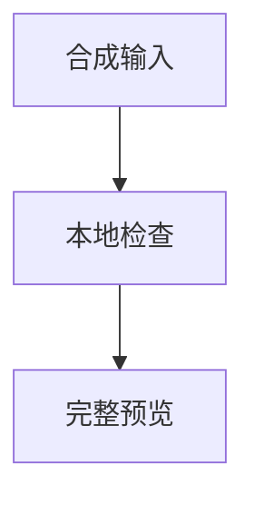

# 合成技术文章验收集

这是纯合成的浏览器验收材料；数值和输出均为示例，不代表硬件性能、官方支持或微信真机结果。

## 环境与阅读结构

> 引用说明：保留原始 Markdown、可复制代码、配图原件及来源信息。

### 代码与命令

```python
message = "按装中文 <tag> & $x$"
if True:
	print(message)
```

```cpp
#include <iostream>
int main() {
	const char* text = "中文 <tag> & \"quote\"";
	std::cout << text;
}
```

```tilelang
import tilelang as T
@T.prim_func
def synthetic_kernel():
	with T.Kernel(1, threads=64):
		T.evaluate(0)
```

```triton
import triton
import triton.language as tl
@triton.jit
def synthetic_kernel(X):
	value = tl.load(X)
	tl.store(X, value)
```

```powershell
$message = "中文 <tag> & 保留引号"
Write-Output $message
$env:SYNTHETIC_VALUE = "example-only"
```

```bash
# Synthetic static example; never executed by the fixture.
printf '%s\n' "中文 <tag> & literal"
```

```text
合成输出日志；按装是必须原样保留的日志字符串。
<result status="ok">literal & data</result>
LLLLLLLLLLLLLLLLLLLLLLLLLLLLLLLLLLLLLLLLLLLLLLLLLLLLLLLLLLLLLLLLLLLLLLLLLLLLLLLLLLLLLLLLLLLLLLLLLLLLLLLLLLLLLLLLLLLLLLLLLLLLLLLLLLLLLLLLLLLLLLLLLLLLLLLLLLLLLLLLLLLLLLLLLLLLLLLLLLLLLLLLLLLLLLLLLLLLLLLLLLLLLLLLLLLLLLLLLLLLLLLLLLLLLLLLLLLLLLLLLLLLLLLLLLLLLLLLLLLLLLLLLLLLLL
OUTPUT-END-Ω
```

#### 宽表格与最后一列

| 配置 | 长词与链接 | 中文说明 | 保留代码 | 最后一列 |
| --- | --- | --- | --- | --- |
| 合成 GPU A | [LONGWORDLONGWORDLONGWORDLONGWORDLONGWORDLONGWORDLONGWORDLONGWORDLONGWORDLONGWORDLONGWORDLONGWORDLONGWORDLONGWORDLONGWORDLONGWORDLONGWORDLONGWORD](https://example.org/synthetic) | 中文说明完整可达中文说明完整可达中文说明完整可达中文说明完整可达中文说明完整可达中文说明完整可达中文说明完整可达中文说明完整可达中文说明完整可达中文说明完整可达中文说明完整可达中文说明完整可达中文说明完整可达中文说明完整可达中文说明完整可达 | `batch_size=1` | FIRST-ROW-END |
| 合成 GPU B | 第二行示例 | 末行数据全部保留 | `dtype="example"` | FINAL-ROW-LAST-COLUMN-Ω |

##### 五级标题：深层大纲保留

下面包含 15 张合成配图，每张都有独立引用、图注与本地素材。


配图 1 后的独立说明段落必须保留。


配图 2 后的独立说明段落必须保留。


配图 3 后的独立说明段落必须保留。


配图 4 后的独立说明段落必须保留。


配图 5 后的独立说明段落必须保留。


配图 6 后的独立说明段落必须保留。


配图 7 后的独立说明段落必须保留。


配图 8 后的独立说明段落必须保留。


配图 9 后的独立说明段落必须保留。


配图 10 后的独立说明段落必须保留。


配图 11 后的独立说明段落必须保留。


配图 12 后的独立说明段落必须保留。


配图 13 后的独立说明段落必须保留。


配图 14 后的独立说明段落必须保留。


配图 15 后的独立说明段落必须保留。

## 公式与流程图

行内公式示例：$x^2 + y^2 = z^2$；保留普通文字与行内代码 `$not_math$`。

$$
\frac{1}{n} \sum_{i=1}^{n} x_i
$$



## 来源与验收边界

来源：[合成材料说明](https://example.org/synthetic-source)。所有命令只作为静态文本显示。

ARTICLE-END-KEEP-Ω
